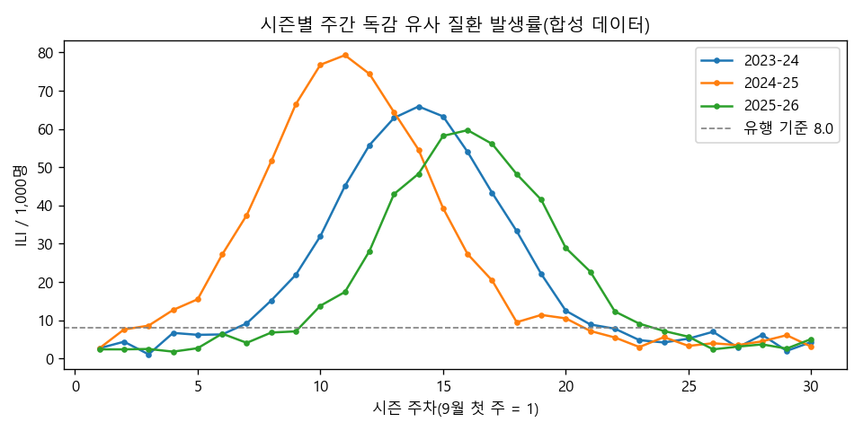
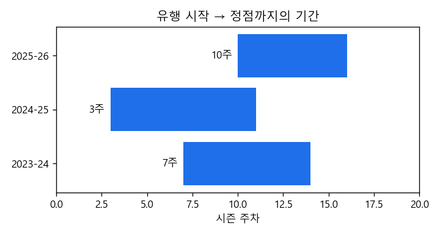

# 계절별 독감 유행 시작 시점 분석

> 데이터 분석가 포트폴리오 예제(「비전공자를 위한 GitHub 완전 정복」 PART 9 프로젝트 C)



| 항목 | 내용 |
|---|---|
| 질문 | 독감 유사 질환 발생률이 언제 유행 기준을 넘는지, 시즌마다 얼마나 다를까? |
| 데이터 | `data/flu_weekly_synthetic.csv` — 교재용 **합성(가짜) 데이터**, 3개 시즌 × 30주 |
| 방법 | Python(pandas, matplotlib). 기준값을 2주 연속 넘은 첫 주를 유행 시작으로 정의 |
| 결과 | 세 시즌 모두 정점보다 6~8주 먼저 유행 기준을 넘음 → [노트북 보기](analysis.ipynb) |
| 배운 점 | 정의(기준값·연속 주수)에 따라 결과가 달라지므로 정의를 함께 공개해야 한다 |



## 재현 방법

```bash
pip install pandas matplotlib jupyter
jupyter notebook analysis.ipynb
```

## 데이터 원칙

실제 감시 자료나 개인 정보는 포함하지 않습니다. 실제 분석에서는 질병관리청 등 공개 자료의 이용 조건을 확인하고 출처를 밝힙니다.
